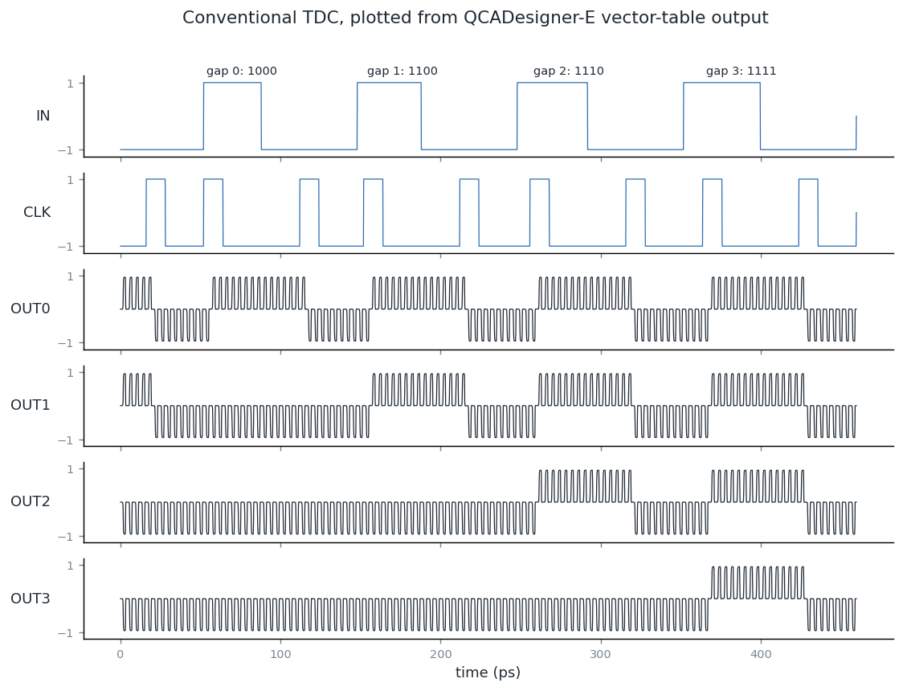

# Time-to-Digital Converter in QCA: a replication attempt

Replication of *"A High-Performance Time-to-Digital Converter in QCA Technology Employing a Low-Power D Flip-Flop"* (Modanlou & Gholami, IEEE Access, 2025) in QCADesigner and QCADesigner-E. Team project for the VLSI course at IIIT Sri City.

## Result

- **The conventional TDC (paper Fig. 1b) works.** 256 cells, 0.292 µm². It gives the paper's output sequence (1000 → 1100 → 1110 → 1111 for STOP 0–3 periods after START) at the paper's ±0.953 output polarization, with 4 ps resolution at a 4 ps clock.
- **The authors' proposed TDC (Fig. 3b) does not reproduce.** Our layout matches the paper's 187-cell count and fixed-cell labels. On the paper's Fig. 8(a) stimulus it gives 1110, 1110, 1110, 0110, 0110 where the paper shows 0000, 1000, 1100, 1110, 1111. That's the same in both the coherence-vector engine and QCADesigner-E.
- **Traced fault:** at the mid-wire delay-line taps, the tap and the latch below it share clock zone 0. That holds the branch cell at −1 while the wire is +1. The published figure may differ from the authors' simulated file, or there may be unstated settings or hidden clock zones, so we don't call the paper wrong. It still needs a check in the Windows QCADesigner GUI.
- **Energy (QCADesigner-E):** 7.37 meV per clock cycle for the conventional TDC (Gaussian clock, r = 80 nm). An independent solver in `simulation/` agrees within 0.5%. Because no proposed design works, **no conventional-vs-proposed saving is claimed**.

Clock-high, temperature and clock-shape sweeps, block-level energies, and why the paper's Table 3 isn't directly comparable: [`simulation/RESULTS.md`](simulation/RESULTS.md).

## Repo

| Path | What |
|---|---|
| `qca-layouts/07_conventional_tdc.qca` | Working conventional TDC (Fig. 1b) |
| `qca-layouts/` | Other working blocks: majority gate, wire + inverter, 2:1 MUX (Fig. 2c), D-latch |
| `vector_tables/` | Vector tables and steps for running them in QCADesigner |
| `simulation/` | QCADesigner-E driver, independent solver, results and plots |
| `archive/` | Layouts that don't work, including the proposed TDC (`09_proposed_tdc.qca`) |
