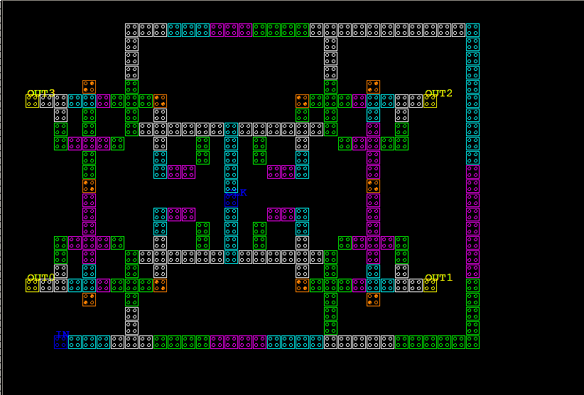
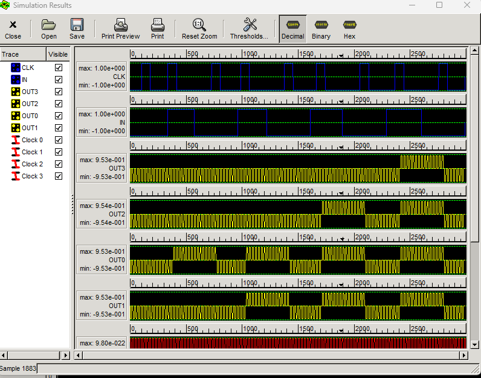
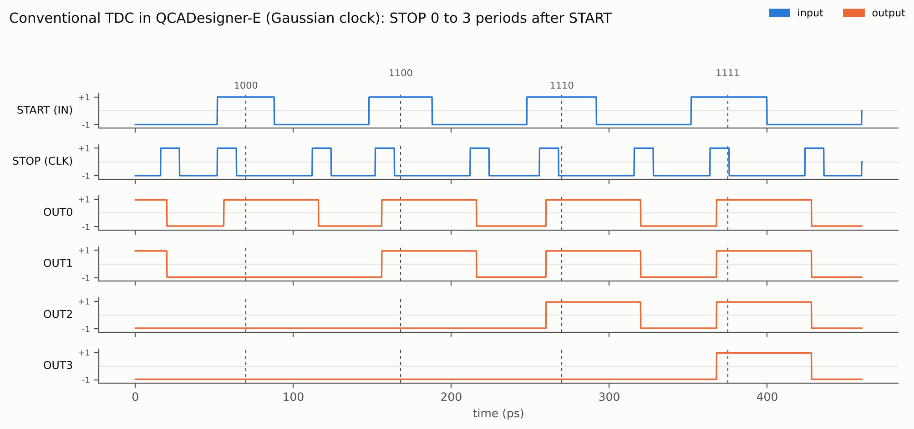

# Wide-range asynchronous time-to-digital converter in QCA

A single-layer QCA TDC for single-photon timing, built on a verified conventional
delay-line TDC. Team project for the VLSI course at IIIT Sri City (Tishya Yadlapalli,
D. Harsha Vardhani).

## Wide-range asynchronous TDC

- **The conventional TDC (paper Fig. 1b) works.** 256 cells, 0.292 µm². It gives the paper's output sequence (1000 → 1100 → 1110 → 1111 for STOP 0–3 periods after START) at the paper's ±0.953 output polarization, with 4 ps resolution at a 4 ps clock. Confirmed in the Windows QCADesigner GUI (screenshots below).
- **The authors' proposed TDC (Fig. 3b) does not reproduce.** Our layout matches the paper's 187-cell count and fixed-cell labels. On the paper's Fig. 8(a) stimulus it gives 1110, 1110, 1110, 0110, 0110 where the paper shows 0000, 1000, 1100, 1110, 1111. That's the same in both the coherence-vector engine and QCADesigner-E.
- **Traced fault:** at the mid-wire delay-line taps, the tap and the latch below it share clock zone 0. That holds the branch cell at −1 while the wire is +1. The published figure may differ from the authors' simulated file, or there may be unstated settings or hidden clock zones, so we don't call the paper wrong. We emailed the authors about the clock zones and have not had a reply.
- **Energy (QCADesigner-E):** 7.37 meV per clock cycle for the conventional TDC (Gaussian clock, r = 80 nm). An independent solver in `simulation/` agrees within 0.5%. Because no proposed design works, **no conventional-vs-proposed saving is claimed**.

Clock-high, temperature and clock-shape sweeps, block-level energies, and why the paper's Table 3 isn't directly comparable: [`simulation/RESULTS.md`](simulation/RESULTS.md).

### Conventional TDC in QCADesigner

Layout, colored by clock zone (256 cells):

Simulation of `vector_tables/07_conventional_tdc.vt`. OUT0 to OUT3 read 1000, 1100, 1110 and 1111 in turn, at ±0.953 polarization:

## Extension: wide-range asynchronous TDC

Beyond the replication, [`coarse_tdc/`](coarse_tdc/README.md) builds a QCA TDC aimed at
single-photon timing:

- a coarse counter (up to 1.02 ns range);
- quarter-period fine capture of edges that arrive at any time (1 ps steps, exact for all
  16 START/STOP phase pairs at 1 K);
- self-re-arming channels with a VALID strobe and internal clear (68 ps dead time);
- a two-channel layout on one clock.

All results are from QCADesigner-E. The 4-bit asynchronous TDC also read correctly at 2 K
(one interval, all four START phases) and failed at 3 K.

## Baseline: conventional delay-line TDC

The starting point is the conventional TDC from Modanlou & Gholami, *IEEE Access*, 2025
(Fig. 1b). Rebuilt here at 256 cells and 0.292 µm², it gives 1000, 1100, 1110, 1111 for STOP
0 to 3 periods after START at ±0.953 output polarization, and dissipates 7.37 meV per clock
cycle (Gaussian clock, r = 80 nm, 1 K). The 187-cell proposed TDC from the same paper did not
reproduce its published codes, so the extension builds on the conventional design. Details:
[`simulation/RESULTS.md`](simulation/RESULTS.md).

## Repo

| Path | What |
|---|---|
| `qca-layouts/07_conventional_tdc.qca` | Conventional TDC (Fig. 1b), the baseline |
| `qca-layouts/` | Other working blocks: majority gate, wire + inverter, 2:1 MUX (Fig. 2c), D-latch |
| `vector_tables/` | Vector tables and steps for running them in QCADesigner |
| `screenshots/` | QCADesigner GUI screenshots of the conventional TDC |
| `simulation/` | QCADesigner-E driver, independent solver, results and plots |
| `coarse_tdc/` | Wide-range TDC: coarse counter (4/8 bits), asynchronous fine capture at 1 ps, self-re-arming and two-channel versions, figures |
| `archive/` | Layouts that don't work, including the proposed TDC (`09_proposed_tdc.qca`) |
