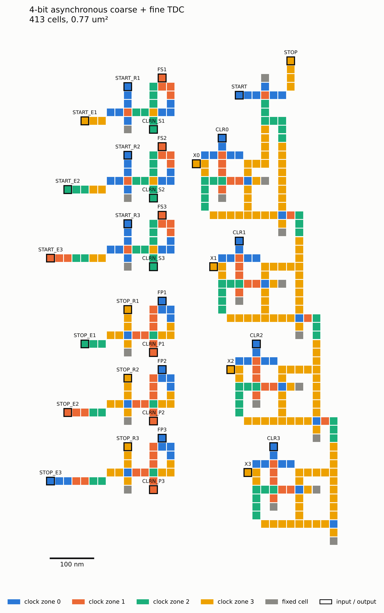
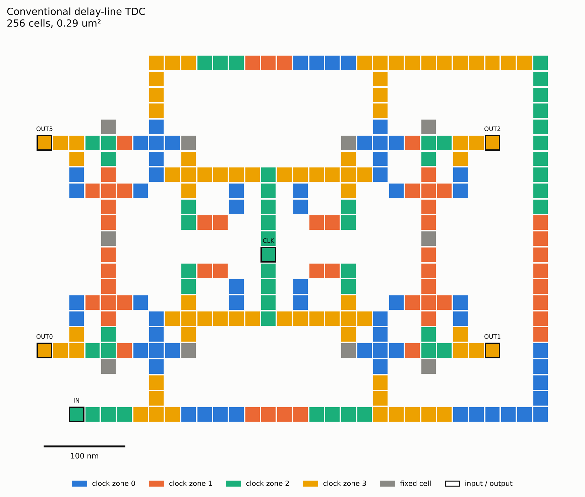

# Wide-range asynchronous time-to-digital converter in QCA

A single-layer QCA TDC for single-photon timing, built on a verified conventional
delay-line TDC. Team project for the VLSI course at IIIT Sri City (Tishya Yadlapalli,
D. Harsha Vardhani).

## Wide-range asynchronous TDC

[`coarse_tdc/`](coarse_tdc/README.md) has the layouts, tests and figures:

- a coarse counter (up to 1.02 ns range at a 4 ps clock);
- quarter-period fine capture of edges that arrive at any time (1 ps steps, exact for all
  16 START/STOP phase pairs at 1 K);
- self-re-arming channels with a VALID strobe and internal clear (68 ps dead time);
- a two-channel layout on one clock.

All results are from QCADesigner-E. The 4-bit asynchronous TDC also read correctly at 2 K
(one interval, all four START phases) and failed at 3 K.

## Baseline: conventional delay-line TDC

The starting point is the conventional TDC from Modanlou & Gholami, *IEEE Access*, 2025
(Fig. 1b). Rebuilt here at 256 cells and 0.292 µm², it gives 1000, 1100, 1110, 1111 for STOP
0 to 3 periods after START at ±0.953 output polarization, and dissipates 7.37 meV per clock
cycle (Gaussian clock, r = 80 nm, 1 K). The 187-cell proposed TDC from the same paper did not
reproduce its published codes, so the extension builds on the conventional design. Details:
[`simulation/RESULTS.md`](simulation/RESULTS.md).

## Repo

| Path | What |
|---|---|
| `qca-layouts/07_conventional_tdc.qca` | Conventional TDC (Fig. 1b), the baseline |
| `qca-layouts/` | Other working blocks: majority gate, wire + inverter, 2:1 MUX (Fig. 2c), D-latch |
| `vector_tables/` | Vector tables and steps for running them in QCADesigner |
| `simulation/` | QCADesigner-E driver, independent solver, results and plots |
| `coarse_tdc/` | Wide-range TDC: coarse counter (4/8 bits), asynchronous fine capture at 1 ps, self-re-arming and two-channel versions, figures |
| `archive/` | Layouts that don't work, including the proposed TDC (`09_proposed_tdc.qca`) |
