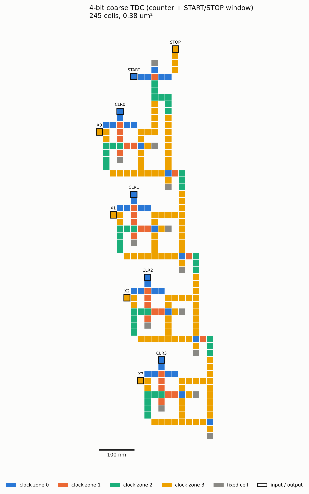
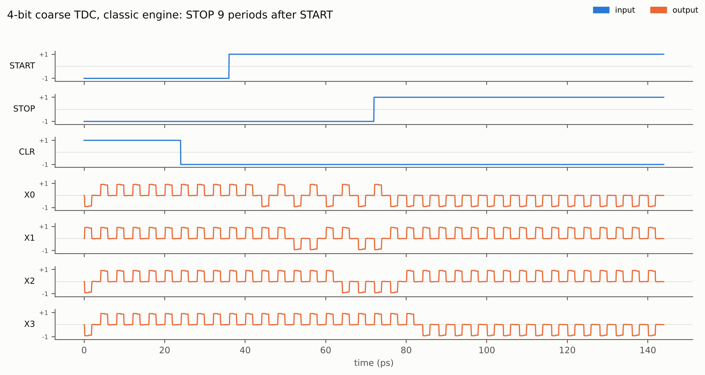
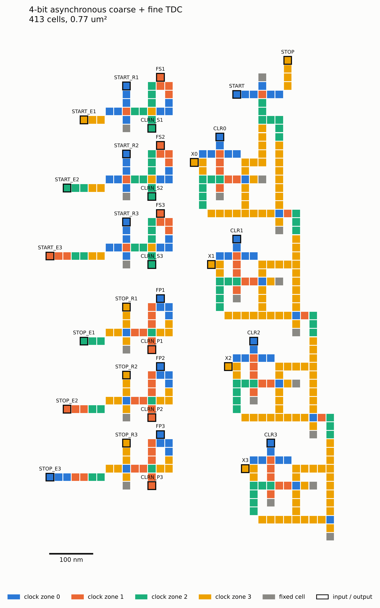
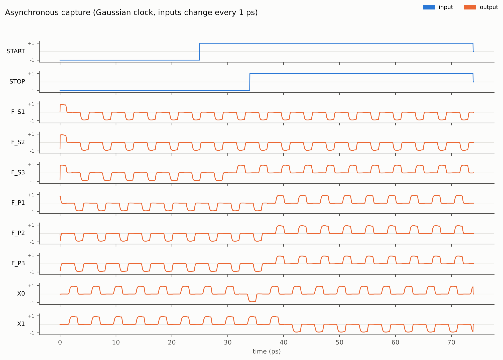
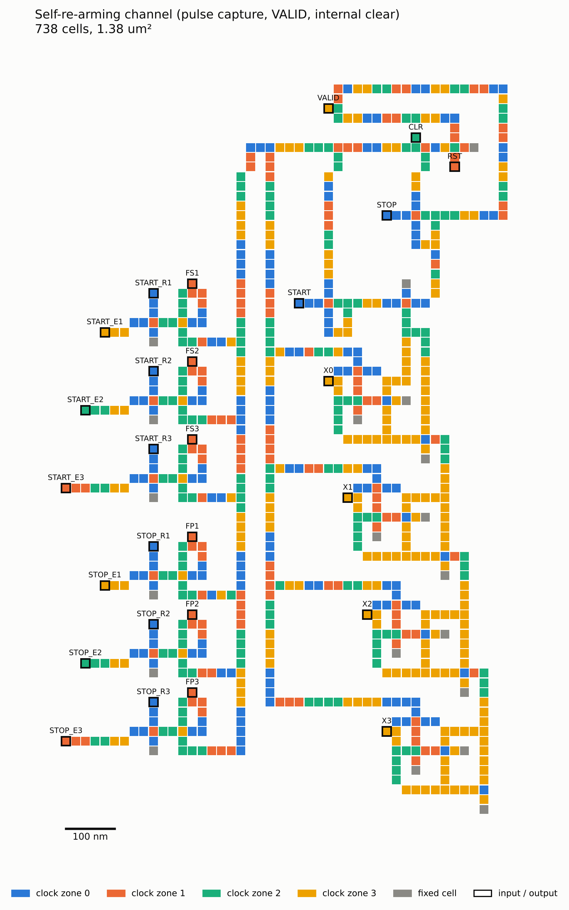
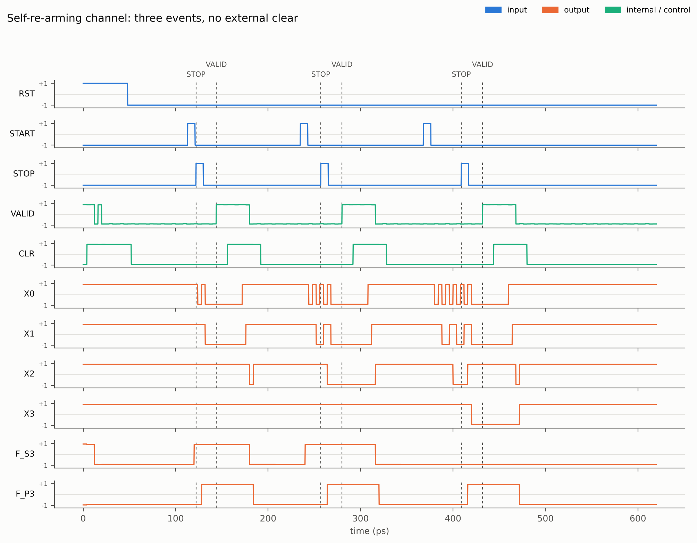
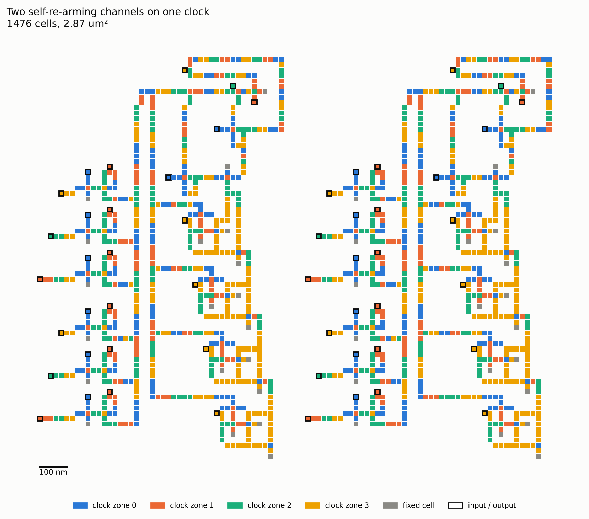

# Wide-range QCA TDC: coarse counter, asynchronous fine capture, self-re-arming channels

The delay-line TDCs elsewhere in this repo cover 4 clock periods (16 ps at a 4 ps clock).
This folder builds a time-to-digital converter that covers nanoseconds, resolves 1 ps, takes
edges that arrive at any time, and clears itself between events.

| Design | Cells | Area | Range | Resolution | Status (QCADesigner-E engine) |
|---|---|---|---|---|---|
| `coarse_tdc4.qca` coarse counter | 245 | 0.38 um² | 60 ps | 4 ps | exact, r = 65/80 nm, classic + Gaussian clock |
| `coarse_tdc8.qca` coarse counter | 473 | 1.05 um² | 1.02 ns | 4 ps | exact (N = 200, 77) |
| `async_tdc4.qca` coarse + fine | 413 | 0.77 um² | 60 ps | **1 ps** | exact for all 16 START/STOP phase pairs |
| `async_tdc8.qca` coarse + fine | 641 | 1.76 um² | 1.02 ns | **1 ps** | exact (D = 601 and 258 quarters) |
| `rearm_tdc4.qca` self-re-arming channel | 738 | 1.38 um² | 60 ps | 1 ps | 3 back-to-back events exact, 68 ps dead time |
| `rearm_2ch.qca` two channels, one clock | 1476 | 2.87 um² | 60 ps | 1 ps | both channels exact, independent |

All results come from the QCADesigner-E simulation engine (Torres et al., IEEE TCAD 2018,
built on QCADesigner 2.0.3), compiled from source and driven from the command line
(`../simulation/`). Logs are in `results/`, figures in `figures/` (PNG and SVG, generated
by `figures.py` from the saved traces in `results/waves/`).

## 1. Coarse counter

`counter_lib.py` builds everything from the ADDLL's verified 2:1 MUX (`addll/addll_lib.mux`).
It's all one layer: no crossings or vias.

- **Toggle bit:** the MUX is closed into a one-period loop, `X' = S ? !X : X`. The counted
  bit is `b = !X`, fed back through an inverting diagonal placed on a clock-zone boundary.
- **Carry:** `carry = S . b` (b before the update), from its own majority gate. The bits
  are stacked diagonally, so each carry drops down a 7-cell wire into the next bit. A ripple
  counter only needs every carry to arrive, not to arrive in the same period.
- **Window:** `EN = START . !STOP` feeds the least significant bit.
- **Clear:** `CLRk = 1` while `EN = 0` forces `X = 1` (b = 0).
- **Reading the count:** `b_k = 1` when `Xk` is negative; count = sum of `b_k * 2^k`.

*STOP rises 9 periods after START. The final outputs read X3..X0 = (−, +, +, −), so
b = 1001 = 9.*

| Test | Result |
|---|---|
| 4-bit, N = 0, 3, 9, 14, 7, 15, classic engine, r = 65 and 80 nm | all exact |
| 4-bit, same N, Gaussian clock, r = 80 nm | all exact; 6.69 meV per cycle (+/- 0.56) |
| 8-bit, N = 200 and 77, classic, r = 65 nm | both exact |

**Against published QCA counters:** the counter alone is 221 cells for 4 bits. A published
4-bit asynchronous QCA counter is 207 cells and 0.22 um² (Gholami group, Eur. Phys. J.
Plus, 2024). This one is about 7% larger, but it has a clear and a START/STOP window, it's
single-layer, and it's verified at two radii and under a Gaussian clock.

**Optimisation history:** version 1 chained the bits side by side with carries looping over
the top (4-bit: 328 cells, 7.70 meV per cycle). Stacking them saved 25% of cells and 13% of
energy.

## 2. Asynchronous capture (coarse + fine)

Real detector pulses don't arrive on clock edges. `fine_lib.py` adds a fine stage that
places each edge to within one clock zone, a quarter period (1 ps).

- **Sampling:** each input is sampled in the reference zone (where the window samples it)
  and also m = 1, 2, 3 quarters earlier.
- **Edge flag:** `f_m = X_ref . !X_early` is 1 only in the first period the reference
  sample sees the edge, and only if the edge came within the last m quarters.
- **Set-latch:** `q' = M(q, f, CLRn)` in a one-period loop (13 cells) holds each `f_m`.
  `F1..F3` form a thermometer code.
- **Result, in quarter periods:** `Q = 4*count + sum(F_P) - sum(F_S)` reads `D + 1`. The +1
  is fixed: the window samples STOP one zone after START, so `D = Q - 1`.

*START rises at 25 ps and STOP at 34 ps (D = 9 quarters). START lands late in its period, so
only `F_S3` sets; all three `F_P` bits set. The count settles at 2:
Q = 4·2 + 3 − 1 = 10 = D + 1.*

**Testing it:** QCADesigner's classic engine ties one input vector to one clock period, so
it can't place an edge mid-period. The QCADesigner-E Gaussian-clock engine has a separate
input period; with `per_vector=0.25`, inputs change every quarter period.

| Test (`test_async.py`) | Result |
|---|---|
| START at each of the 4 quarter phases, D = 9, at r = 80 and 65 nm | Q − D = 1 for all |
| D = 8, 10, 11 at every START phase; plus (0, 10) and (1, 6) | Q − D = 1 for all 14 |
| Phase coverage: (START phase, STOP phase) pairs | all 16 of 16 exact |
| 8-bit: D = 601 and 258 quarters (150 ps, 65 ps) | Q − D = 1 for both |
| Energy, 4-bit / 8-bit (Gaussian clock, r = 80 nm) | 11.4 / 15.4-17.0 meV per cycle |

**Linearity:** every phase pair reads the same offset, so in simulation the differential
and integral non-linearity are both 0 LSB. The remaining timing error is the quantisation
of a 1 ps step: 1/√12 ≈ 0.29 ps rms.

**Optimisation:** the early-sample wires were cut from 3-cell to 2-cell zone segments, and
the blocks were moved in: 425 → 413 cells, 0.93 → 0.77 um², same results. 1-cell segments
fail (the thermometer collapses).

## 3. Temperature

QCA as simulated here is a cryogenic technology, so the asynchronous 4-bit TDC was run at
the operating temperatures of superconducting single-photon detectors (SNSPDs, ~1-4 K).

| T | Result |
|---|---|
| 1 K (default) | exact |
| 2 K | exact (Q − D = 1 at all four START phases) |
| 3 K | fails (reads garbage) |
| 4 K | fails |

It works up to 2 K: the cold end of the SNSPD range, not all of it.

## 4. Self-re-arming channel

`rearm_lib.py` turns the TDC into a channel that runs without an external controller.

- **Pulse inputs:** START and STOP are pulses (at least 2 periods wide). Each sets a
  one-gate latch (`S_L`, `P_L`), so the window `EN = S_L . !P_L` is a held level. The fine
  samplers watch the raw pulses.
- **VALID:** `P_L` feeds a 7-period delay line. After 5 periods it raises `VALID`: the
  count and fine bits are ready to read.
- **Self-clear:** after 7 periods the line drives `CLR`. It clears the counter bits (bus 1,
  active high) and every latch (bus 2 and two local taps, active low). Clearing `P_L` empties
  the line, so `CLR` drops 7 periods later and the channel is armed again.
- **Power-up:** a `RST` pad is OR'd into `CLR`.
- **Why there's no logic to block extra pulses mid-measurement:** an SNSPD needs
  nanoseconds to recover after it fires, far longer than this channel's 68 ps cycle, so one
  detector can't fire twice inside a measurement.

*Clocked signals are drawn as their value in each clock period (the value a reader
samples). After `RST`, three START/STOP pulse pairs arrive with no external clear. After
each STOP, VALID rises, the counter holds 3, 7 and 11 (b3..b0 = 0011, 0111, 1011), then CLR
wipes the counter and latches and the channel is ready for the next pulse pair.*

| Event (`test_rearm.py`, Gaussian clock, r = 80 nm) | count | F_S | F_P | Q | Q − D |
|---|---|---|---|---|---|
| START at quarter 1, D = 9 | 3 | 001 | 011 | 13 | 4 |
| START at quarter 3, D = 22 | 7 | 111 | 001 | 26 | 4 |
| START at quarter 0, D = 41 | 11 | 000 | 001 | 45 | 4 |

The offset is 4 here, not 1 as in section 2, because the pulse latches add a fixed delay.
It's the same for every event, so it calibrates out. Energy: 20.0 meV per cycle
(+/- 1.66).

**Dead time** (STOP to CLR released): 68-69 ps, i.e. 17 periods, the same for every event.
After `RST`, wait 16 periods before the first event, so the clear reaches every latch.

**Two design rules this needed** (both found by simulation):

- A gate input driven by a clocked wire needs its last two cells in the zone before the
  gate. A single buffer cell works for a fixed or input cell, but not for a wire; the latch
  locked up until the clear lines were extended into the buffer's zone.
- An inverting diagonal works off the end of a vertical run (as in the ADDLL's ENB
  inverter). Off a horizontal run, it didn't invert in place.

**Optimisation:** the delay line was shortened from 9 to 7 periods and folded over the
counter instead of running out to the side: 768 → 738 cells, 2.24 → 1.38 um².

## 5. Two channels on one clock

`test_2ch.py` places two self-re-arming channels side by side. They share only the clock;
each has its own START, STOP, RST, VALID and clear network.

Each channel gets its own START phase and interval. Both read correctly, and neither
disturbs the other:

| Channel / event (`test_2ch.py`, Gaussian clock, r = 80 nm) | count | F_S | F_P | Q | Q − D | dead time |
|---|---|---|---|---|---|---|
| A: START at quarter 1, D = 9 | 3 | 001 | 011 | 13 | 4 | 68.2 ps |
| A: START at quarter 2, D = 30 | 9 | 011 | 000 | 34 | 4 | 70.2 ps |
| B: START at quarter 3, D = 17 | 6 | 111 | 000 | 21 | 4 | 70.2 ps |
| B: START at quarter 0, D = 6 | 2 | 000 | 011 | 10 | 4 | 68.2 ps |

Energy: 40.5 meV per cycle (+/- 3.39) for both channels, about twice one channel (20.0).

## Why: single-photon timing for biomedical imaging

Time-correlated single-photon counting, time-of-flight PET and fluorescence lifetime imaging
all need a TDC per pixel or channel.

- **PET:** these detectors run at room temperature, which QCA as simulated here (≤ 2 K)
  can't.
- **Superconducting single-photon detectors (SNSPDs):** a better fit. They already sit at
  1-4 K, and the cooling budget limits how many wires can leave the cryostat, so
  time-tagging next to the detector matters. Today this is done with cryo-CMOS or
  superconducting logic.

The fair pitch: a wide-range asynchronous coarse-fine QCA TDC (1 ps steps, ns range,
self-re-arming, multichannel), proposed as the timing core for cryogenic single-photon
detectors.

## Limits

- **QCA is simulation-only.** Nobody fabricates QCA circuits at this scale.
- **Noise isn't modelled.** QCADesigner doesn't model noise, so timing jitter beyond the
  0.29 ps quantisation limit can't be estimated here. Metastability isn't modelled either:
  an edge landing exactly as a sampler switches is resolved by the engine's deterministic
  maths.
- **Input pads are copied.** Each fine sampler has its own input cell (`START_R1`,
  `START_E1`, ...), modelling one pad fanned out. The fan-out wiring isn't in the cell
  counts.
- **Temperature limit:** it works up to 2 K, not 4 K.
- **No GUI runs.** QCADesigner 2.0.3 can't run the asynchronous tests (it ties inputs to the
  clock). The coarse counter can run there (below).

## Running the coarse counter in QCADesigner

`gui_test/coarse_tdc4.qca` with `gui_test/coarse_tdc4_test.vt`:

1. Simulation Engine Setup: **Coherence Vector**, with the settings in
   `../vector_tables/README.md`.
2. Enter **Total Simulation Time = `4.28e-10`** exactly (107 vectors × 4 ps). A total time
   10× too short is enough to break a sequential circuit.

| Read near | X3 X2 X1 X0 (sign) | b3..b0 | Count |
|---|---|---|---|
| 112 ps (26% along) | + + − − | 0011 | 3 |
| 256 ps (60% along) | − + + − | 1001 | 9 |
| 420 ps (98% along) | − − − + | 1110 | 14 |

## Files

| File | What |
|---|---|
| `counter_lib.py` | Toggle bit, counter chain, START/STOP window |
| `fine_lib.py` | Fine stage (samplers, edge flag, set-latch), `async_tdc()` |
| `rearm_lib.py` | Self-re-arming channel: pulse latches, delay line, VALID, CLR network |
| `test_bit.py`, `test_counter.py` | One bit; n-bit coarse TDC (`NB`, `ENGINE=gauss`, `WAIT`) |
| `test_fine.py`, `test_async.py` | One edge's fine stage; full coarse + fine TDC (`NB`, `RADIUS`, `QCA_T`) |
| `test_rearm.py`, `test_2ch.py` | Re-arming channel with event trains; two channels |
| `figures.py` | Layout renders and waveform plots (set `SAVE=results/waves/x.npz` on a test to keep its traces) |
| `make_gui.py` | Writes the coarse layouts and the GUI vector table |
