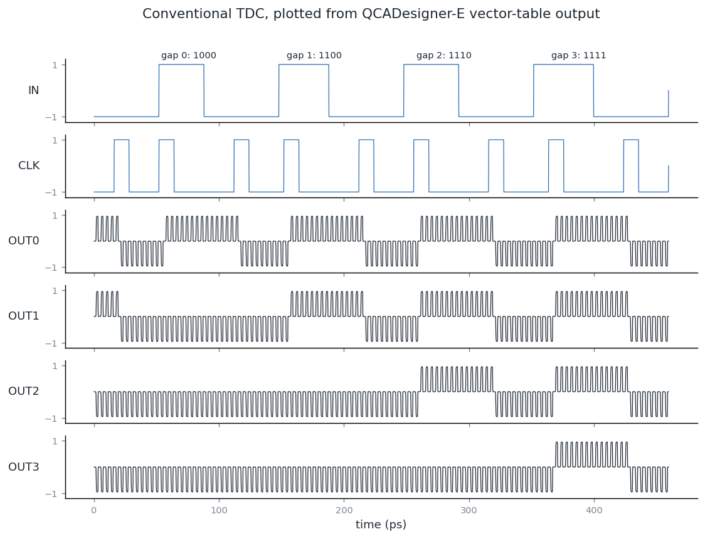
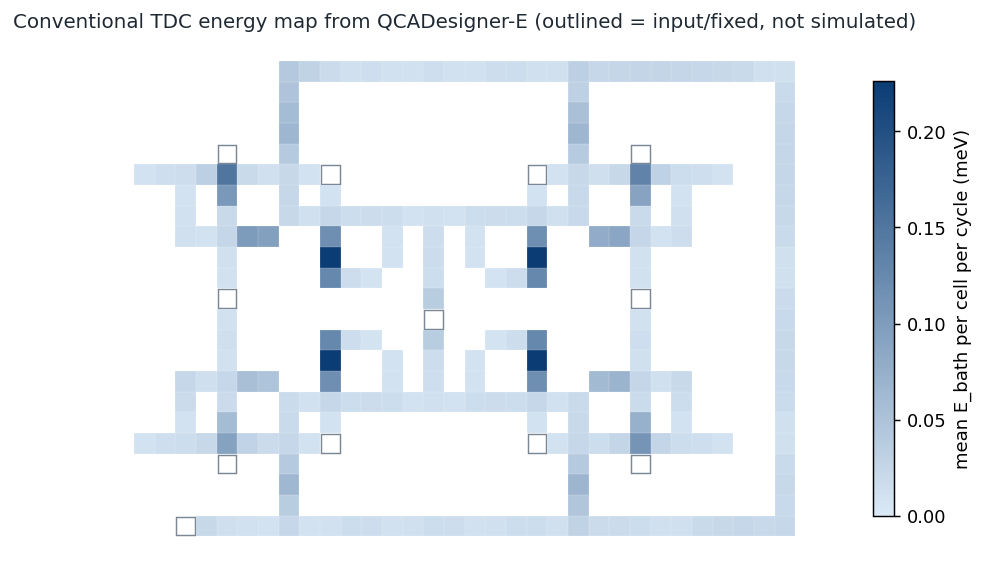

# Results

Numbers come from the **QCADesigner-E** engine source, compiled and run headless on macOS.
They have not yet been reproduced in the Windows QCADesigner GUI. Raw values are in `results/`.

## Conventional TDC (paper Fig. 1b)

256 cells, 0.292 um^2. Cell positions and clock zones were read from the vector drawing in
the paper's PDF. Zones the figure hides (input, output, fixed and unlabelled yellow cells)
were inferred from neighbours and the mirrored cell.

| STOP after START | OUT0..3 |
|---|---|
| 0 periods | 1000 |
| 1 period | 1100 |
| 2 periods | 1110 |
| 3 periods | 1111 |

This matches the sequence in the paper's Fig. 7(a), with output polarization of +/-0.953
(paper: 0.953). One code step per clock period gives 4 ps resolution at a 4 ps clock.

## Energy per clock cycle, whole circuit (QCADesigner-E)

| Settings | Correct codes | E_bath (meV) | Error (meV) | P at 250 GHz (nW) | P at 1 GHz (pW) |
|---|---|---|---|---|---|
| Gaussian clock, r = 80 nm (engine default) | yes | **7.37** | 0.62 | 0.295 | 1.18 |
| Gaussian clock, r = 65 nm | yes | 7.33 | 0.62 | 0.294 | 1.17 |
| Cosine clock, r = 65 nm | **no** (all 0000) | 8.51 | 0.64 | - | - |
| Cosine clock, r = 80 nm | **no** (all 0000) | 8.40 | 0.63 | - | - |

P = E x f (paper eq. 6). Energy was simulated at a 4 ps clock only, so 250 GHz is the
self-consistent column. The 1 GHz column is arithmetic for comparison with the paper; a
slower clock would really dissipate less per cycle. The error is the engine's own
E_bath + E_clk + E_io balance.

The design also gives correct codes in the classic coherence-vector engine, the engine
type the paper names, at r = 65 and 80 nm (`results/classic_engine.json`). That engine uses
a steeper clamped cosine than the energy engine's cosine option, and reports no energy.

### Clock-high sweep (kink energy Ek = 1.484 meV between adjacent cells)

| Clock high | Correct codes | E_bath (meV) |
|---|---|---|
| 0.5 Ek | no (all 1110) | 1.15 |
| 1.0 Ek | no (all 1110) | 3.77 |
| 1.5 Ek | yes | 7.08 |
| default (9.8e-22 J = 4.1 Ek) | yes | 7.37 |

### Temperature (Gaussian clock, r = 80 nm)

| T (K) | Correct codes | Smallest peak polarization | E_bath (meV) |
|---|---|---|---|
| 1 | yes | 0.953 | 7.37 |
| 5 | no (all 1111) | 0.902 | 5.66 |
| 10 | no (all 1111) | 0.615 | 3.42 |
| 20 | no (all 1111) | 0.026 | 2.43 |

Energy values in rows marked "no" describe a circuit that is not working, so do not quote
them as operating figures.

### Where the energy goes

The hottest cells (0.226 meV per cycle each) are in the edge converters, next to the
diagonal inverter. The paper's Fig. 7(b) also shows dark cells around the edge converters.

## Working blocks

| Block | File | Cells | Area (um^2) | E_bath (meV/cycle) | Error (meV) |
|---|---|---|---|---|---|
| Majority gate | `01_majority_gate.qca` | 5 | 0.0034 | 0.145 | 0.015 |
| Wire + inverter | `02_wire_inverter.qca` | 11 | 0.0218 | 0.519 | 0.051 |
| 2:1 MUX, paper Fig. 2(c) | `08_mux2to1_fig2c.qca` | 12 | 0.0096 | 0.581 | 0.060 |
| D-latch, hand-built | `DFlipFlop.qca` | 22 | 0.0186 | 0.303 | 0.025 |

`DFlipFlop.qca` keeps its original name, but it behaves as a level-sensitive D-latch.
Block energy depends on the input pattern; these are for the test sequences in `run_qde.py`.

## Authors' proposed TDC does not reproduce (see `archive/`)

`archive/09_proposed_tdc.qca` is the paper's Fig. 3(b) read from the PDF: 187 cells, matching
the paper's count and the -1.00 fixed-cell labels and dots. It was run with the stimulus
read from the paper's Fig. 8(a).

| Engine | Codes for the 5 measurements | Paper Fig. 8(a) |
|---|---|---|
| Coherence vector, r = 65 and 80 nm | 1110, 1110, 1110, 0110, 0110 | 0000, 1000, 1100, 1110, 1111 |
| QCADesigner-E, Gaussian, r = 80 nm | 1110, 1110, 1110, 0110, 0110 | same |
| QCADesigner-E, cosine, r = 65 nm | 0000, 0000, 0000, 0000, 0000 | same |

The traced fault is at the mid-wire delay-line taps: the tap and the latch below it share
clock zone 0, so the branch cell is held at -1 while the wire is +1. Possible explanations
not ruled out: the published figure differing from the simulated file, unstated settings,
or hidden clock zones on input, output and fixed cells. Run it in the Windows QCADesigner
GUI (`archive/09_proposed_tdc_fig8.vt`) before calling the paper wrong.

Because no proposed design works here, **no conventional-vs-proposed saving is claimed**.

## Comparison with the paper's Table 3

Not directly comparable. The paper gives conventional switching 0.33 / 0.302 / 0.2518 and
leakage 0.066 / 0.216 / 0.4 at 0.5 / 1 / 1.5 Ek, with meV in the table header but eV in the
text. It does not name its energy tool. A switching/leakage split at those levels is the
format QCAPro reports; QCADesigner-E reports bath dissipation, a different quantity.

## Cross-check

The independent solver in this folder gives 7.40 meV for the same conventional TDC run,
within 0.5% of QCADesigner-E (`results/results.json`).
